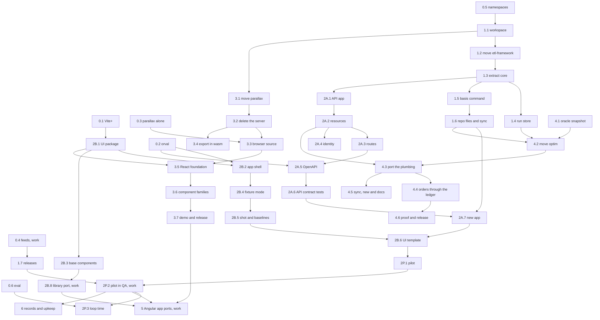

# Roadmap

This roadmap is the build order for basis: seven phases, the steps in each, what each step needs first, and when it is
done. Steps in different lanes run at the same time. For the reasons behind each piece, see [the design](design.md).

Steps marked **(work)** need the firm's environment: a Citrix desktop, the Azure DevOps feeds and pipelines, the QA
environment, or the Angular library and apps. They are the maintainer's to run or hand on, with the exact commands to
run and what to send back. Every other step runs here, against containers and synthetic data.

## Lanes

| Lane | Builds | Phases |
|---|---|---|
| A. Python | `basis-core`, `basis-job`, `basis-api` | 1, 2A, 6 |
| B. UI | `@basis/ui` | 2B |
| C. Parallax | `@basis/parallax` | 3 |
| D. Optim | `optim` | 4 |
| E. Eval | `evals/` | 0, then every phase |
| F. Ports | the firm's Angular apps | 5 |

The critical path runs through lane A and joins lane B at the pilot: the namespace spike, the workspace, etl-framework's
move, `basis-core`'s extraction, the repo files, `new app`, and the pilot. Lane B needs only the Vite+ and orval spikes
to start, so it runs alongside phase 1. Parallax and optim are off the critical path, and so is the port of the Angular
library's components, which happens at the firm.

At the busiest point, in phase 2, about ten agents work at once: two or three in lane A, two or three in lane B plus the
library port's component families at the firm, up to four in lane C while its component families are ported, one or two
in lane D, and one in lane E.

## Rules for working in parallel

1. Each step is one branch and one git worktree, named after its id, such as `1.3-extract-core`, and merges to `main`
   through a pull request whose CI is green.
2. Changes to `basis-core` land one pull request at a time. A lane that needs a change to `basis-core` opens that pull
   request on its own, and builds on it after it merges, so that two lanes never reshape it at once.
3. Steps in the same package split by module or component family, so that two agents never edit the same files.
4. A step ends with the repo's checks green and its docs updated. A spike ends with its written result in
   `docs/spikes/`.
5. A step marked **(work)** goes to the maintainer as a list of commands to run and what to send back.

## Phase 0: spikes

Every spike runs at once. Each writes `docs/spikes/NAME.md` with the versions it used, a yes or no for each question,
and the fallback for each no.

1. **0.1 Vite+.** Create a React app with `vp create` and answer:
   - which of Oxlint's rules conflict at the design's strictest settings, and which one of each pair to turn off;
   - whether type-aware Oxlint and tsdown's declaration files work on the TypeScript 7.1 beta;
   - whether the React Compiler's `panicThreshold: "all_errors"` fails a build on a component that breaks its rules;
   - whether Oxlint has `no-restricted-imports` and `no-restricted-globals` built in;
   - whether `vp staged` runs from a hook script that basis installs.

   **(work)** Install `vp` on a Citrix desktop without admin rights, and run `vp install` from the internal npm feed.
   Done when the result names the exact Oxlint configuration, as the `vite.config.ts` preset that step 2B.1 starts from.
2. **0.2 orval.** Write a FastAPI app with strict models, operation ids taken from handler names, a list endpoint and an
   endpoint that returns Arrow. Generate its client with orval while TypeScript 7 is installed, and check for Zod 4
   strict objects, TanStack Query v5 hooks, MSW 3 handlers, and a binary response for the Arrow endpoint. The fallback
   is @hey-api/openapi-ts, if it runs with TypeScript 7. Done when the result holds the orval configuration step 2B.2
   uses, and the OpenAPI conventions step 2A.5 implements.
3. **0.3 Parallax alone.** Load Arrow bytes into parallax's worker with no server, build `parallax-export` for wasm32
   with rust_xlsxwriter's in-memory mode and save an xlsx from the browser, and measure the largest table that loads and
   pivots within the existing budgets in headless Chromium with software rendering. **(work)** Repeat the measurement on
   a Citrix desktop. Done when the result states the row limit.
4. **0.4 Feeds (work).** On a Citrix desktop:
   - set a user-level `uv.toml` that makes the Azure Artifacts feed the default index, with keyring or token
     authentication, then `uvx` a test package from it;
   - install a test npm package through `vp install`;
   - publish a wheel and an npm package from an Azure DevOps pipeline.

   Done when the result holds the pipeline steps for publishing, which step 1.7 uses.
5. **0.5 Namespaces.** Build a uv workspace of two distributions that both add to the `basis` namespace (`basis.core`,
   `basis.job`). Check editable installs, ruff, ty, grimp and an import-linter contract across them, then build a wheel
   of each. The fallback is top-level names: `basis_core` and `basis_job`. Done when the result says which names phase 1
   uses.
6. **0.6 Eval.** Install Harbor and write five tasks against etl-framework 0.1.0, which exists today, graded by its own
   checks. Run one agent three times per task, and report the pass rate, the consistency across runs, the loop time and
   the tokens. Done when `evals/` holds the tasks, the runner and a first report.

## Phase 1: the repo and basis-core

Lane A. Needs spike 0.5.

1. **1.1 Workspace.** Set up `packages/core` and `packages/job` as uv workspace members, with:
   - root ruff and ty settings with every rule an error, as etl-framework has them;
   - the import contract: `core` imports nothing else, and `job`, `api` and `optim` import `core` only;
   - GitHub Actions CI, which runs only the jobs whose paths changed;
   - this repo's own commit hook.

   Done when an empty `core` and `job` pass CI.
2. **1.2 Move etl-framework.** Bring etl-framework into `packages/job` with its history (`git subtree add`, or `git
   filter-repo` and a merge), with its code and tests unchanged. Needs 1.1. Done when its 90 unit and 33 integration
   tests pass in this repo's CI, against SQL Server and Oracle service containers.
3. **1.3 Extract basis-core.** Move to `packages/core`:
   - each dialect's read and write paths, from `databases/`;
   - `settings`, `logs`, `storage` and `snapshots`;
   - publishing with the ledger;
   - the generic halves of `runs` (`replay`, `regress`, `resume`);
   - the `new` and `sync` machinery, and the shared templates;
   - the contract-test helpers: the `ContractTests` base, the import check's `FORBIDDEN` list, and `check_agent_files`.

   `basis.job` keeps the job contract (`job`, `params`, `rows`, `inputs`, `outputs`, `interval`, `changes`,
   `destination`, `ddl`, `diff`, its loader) and its example, templates, skills and docs. Imports are renamed from
   `etl_framework` to `basis.job` and `basis.core`. Needs 1.2. Done when the same 123 tests pass, split across the two
   packages, and the import contract holds.
4. **1.4 Run store.** Add content-addressed objects and manifests to `basis.core`. `basis.job` writes its snapshots
   there, and `replay`, `resume` and `regress` read them. Needs 1.3. Done when a run that loads the same input twice
   stores it once, and `replay`, `resume` and `regress` pass their tests on the new layout.
5. **1.5 The basis command.** Build `basis.core`'s command, with subcommands that installed packages add through entry
   points:
   - `basis.core`: `check`, `sync`, `replay`, `regress` and `docs`;
   - `basis.job`: `run`, `resume`, `ddl`, `describe` and `list`;
   - a scaffolding command per package, starting with `basis-job new repo` and `new job`.

   Needs 1.3, and can run alongside 1.4.
6. **1.6 Repo files and sync.** Add `basis.core`'s templates:
   - the Dockerfile: one image under `tini`, with `basis serve` and `basis run JOB --publish`;
   - `azure-pipelines.yml`, calling the team's templates (the real steps come from spike 0.4);
   - `.githooks/pre-commit`, plus setting `core.hooksPath` from any `basis` command;
   - `AGENTS.md` blocks per package, prefixed skills with their `.claude/skills/` copy, and the drift check.

   Needs 1.5. Done when `uvx --from 'git+https://github.com/jacobragsdale/basis#subdirectory=packages/job' basis-job new
   repo loads` makes a repo that passes `basis check`, whose image builds, runs its example job and publishes it to the
   SQL Server container.
7. **1.7 Releases.** Tags build each package's wheel and attach it to a GitHub release, and a CI job tests each package
   against the oldest `basis-core` its range allows (`uv sync --resolution lowest-direct`). **(work)** Publish to the
   internal feeds through Azure DevOps, with spike 0.4's steps. Point etl-framework's README at basis; archiving that
   repo is the maintainer's call. Needs 1.6. Done when `core-v0.1.0` and `job-v0.1.0` are tagged and install from git
   here and from the internal feed at the firm.

## Phase 2: APIs and the UI

Lanes A and B at once. Lane A needs step 1.3. Lane B needs spikes 0.1 and 0.2, and nothing from phase 1 until step 2B.6.

### Lane A: basis.api

1. **2A.1 The app.** Build the FastAPI app from a service's declarations, with:
   - settings;
   - JSON logs and OpenTelemetry traces;
   - RFC 9457 errors from one exception map;
   - health and readiness endpoints;
   - graceful shutdown;
   - `basis serve`.
2. **2A.2 Resources.** Add declared resources: databases, through `basis.core`'s dialects, whose writes commit in one
   transaction after the handler returns and the response validates; an HTTP client; a cache; and the clock and ids.
   Every resource call gets a deadline and a trace span, and every resource a fake. Its changes to `basis.core` follow
   rule 2. Needs 2A.1.
3. **2A.3 Routes.** Add strict request models; each route's declared deadline, response model and errors; declared pure
   compute running in a process pool; and `basis call ROUTE`. Needs 2A.2, and runs alongside 2A.4.
4. **2A.4 Identity.** Verify the JWT's signature, expiry, issuer and audience. A missing token is anonymous and an
   invalid one gets a 401. Handlers see `User | None`, and the development signing key is refused anywhere but a laptop.
   Needs 2A.2.
5. **2A.5 OpenAPI.** Commit `openapi.json`, with operation ids taken from handler names, strict models publishing
   `additionalProperties: false`, Arrow responses, and a check that flags a breaking change. Needs 2A.3 and spike 0.2's
   conventions.
6. **2A.6 Contract tests.** The app builds on fakes; every route declares what it must; `openapi.json` is current;
   Schemathesis runs on fakes; the import check passes; the agent files match. Needs 2A.5.
7. **2A.7 New app.** `basis-api new app NAME` writes the API part, adds jobs through `basis.job`'s generator, and writes
   `basis.core`'s repo files. Needs 1.6 and 2A.6. Done when a generated app with an API and a job passes `basis check`,
   and its image serves the API and runs the job.

### Lane B: @basis/ui

1. **2B.1 The package.** Set up `packages/ui` in a pnpm workspace, with:
   - the Vite+ preset from spike 0.1, as a function that an app's `vite.config.ts` spreads in;
   - the strict tsconfig;
   - the library build with tsdown;
   - Vitest's browser mode with the Playwright provider.
2. **2B.2 App shell.** Add TanStack Router and Query; spike 0.2's orval preset and custom fetch, which attaches the JWT;
   a sign-in adapter interface with a fake for tests; error display; and telemetry. Needs 2B.1, and runs alongside 2B.3.
3. **2B.3 Base components.** Build the components every app needs (layout, forms, small tables, dialogs, toasts) on Base
   UI and Tailwind 4, with the firm's theme as the only palette. They set the patterns the library port follows. Needs
   2B.1.
4. **2B.4 Fixture mode.** Fixture mode serves the MSW handlers that orval generates, plus recorded responses read from a
   reachable run store, which are never committed. `basis dev` starts the app on fixtures on a free port per worktree.
   Needs 2B.2.
5. **2B.5 Screenshots.** `basis shot ROUTE` writes a screenshot, the accessibility tree and the console errors. Visual
   baselines live in a pinned Playwright Linux image in CI, and a skill covers driving the app with Playwright CLI.
   Needs 2B.4.
6. **2B.6 UI template.** Add the UI part to `basis-api new app --ui`, kept current by `sync`. Needs 2A.7 and 2B.5.
7. **2B.7 Sign-in (work).** Write the adapter for the firm's sign-in system. Needs 2B.2.
8. **2B.8 Library port (work).** Inventory the Angular library, then port one component family per agent at once. Each
   family is compared by screenshot with its Angular original on the same fixture. Needs 2B.3.

### The pilot

Lanes A, B and E join here.

1. **2P.1 Pilot.** Create a pilot with `uvx basis-api new app pilot --ui --job load-positions`. Its API reads from the
   SQL Server container and its job writes to it, its UI runs both on fixtures and against the API, and it has a
   parallax page once step 3.7 is done. Needs 2B.6.
2. **2P.2 Pilot in QA (work).** Create the pilot from the internal feeds and deploy it to QA through its generated
   pipeline and the team's templates, with the branch policy on `main` in place. Needs 2P.1 and 1.7.
3. **2P.3 Loop time.** Lane E adds API and UI tasks to the eval and runs them against the pilot. Done when `new app`
   reaches QA in one pipeline run, and the loop time is recorded against the hook's one-minute budget.

## Phase 3: parallax in the browser

Lane C. Needs step 1.1 to move in, and spike 0.3 for the browser source. It runs alongside phase 2.

1. **3.1 Move parallax.** Bring parallax into `packages/parallax` with its history. Its Rust and wasm builds run in CI
   only when its paths change.
2. **3.2 Delete the server.** Remove `parallax-server`, `parallax-sources`, the client's server paths, the registry,
   `/copy` and `/export`, and CI's database containers. Done when the engine, session and protocol tests pass, the
   DuckDB and Perspective comparisons included.
3. **3.3 Browser source.** Load Arrow bytes from the app. The app passes in its load status, and the row limit from
   spike 0.3 is enforced with a clear error. Needs 3.2 and spike 0.3.
4. **3.4 Export in wasm.** Move xlsx and CSV export into the wasm build, as spike 0.3 found it works. Needs 3.2, and
   runs alongside 3.3.
5. **3.5 React foundation.** Add the provider, the worker connection and the hooks every component uses, built on
   `@basis/ui`'s preset. Needs 3.3 and 2B.1.
6. **3.6 Component families.** Port four families at once, one agent each:
   - the grid, with its filters, toolbar, menus and column tools;
   - the pivot, with its group menu and field list;
   - charts, with technical-analysis panes and drawings;
   - the shared pieces.

   Each family's existing Playwright specs and pixel baselines are rewritten for React. Needs 3.5.
7. **3.7 Demo and release.** Rebuild the demo as a React app on `@basis/ui` with fixture data. Its screenshot tests run
   at threshold 0 in the pinned image. Tag `parallax-v0.1.0`. Needs 3.4 and 3.6.

## Phase 4: optim on basis-core

Lane D. Needs steps 1.4 and 1.6. Its plumbing port waits for step 2A.2's changes to `basis-core` to merge, so that
`basis-core` isn't reshaped under it. It runs alongside phase 2.

1. **4.1 Oracle snapshot.** With optim 0.2.0 as it is, run the example model on its fixture, and keep the snapshot and
   its decisions as the oracle for step 4.6. It can run at any time before 4.2.
2. **4.2 Move optim.** Bring portfolio-optim into `packages/optim` with its history.
3. **4.3 Port the plumbing.** Replace optim's sources, settings, logs, storage and snapshots with `basis.core`'s, and
   delete optim's copies, the SQL Server snapshot defect with them. optim's per-portfolio batching (ids bound as JSON, a
   semaphore per source, a read-only transaction per batch) stays optim's own, built on `basis.core`'s reads. Needs 4.2
   and 2A.2.
4. **4.4 Orders through the ledger.** Orders are written through `basis.core`'s publishing, with a ledger row in the
   same transaction, and `resume` finishes a partial write. Needs 4.3.
5. **4.5 Sync, new and docs.** Move optim's `sync`, `new` and docs printing onto `basis.core`'s machinery. optim's
   templates, skills and docs stay its own, and `uvx optim new repo` works from the feed. Needs 4.3, and runs alongside
   4.4.
6. **4.6 Proof and release.** Done when the example model's decisions on its fixture match step 4.1's exactly (`optim
   regress` against its snapshot), and a generated model repo with a second model passes its checks. Then tag optim's
   release. Needs 4.4 and 4.5.

## Phase 5: the Angular apps

Lane F (work). Needs step 2P.2, the component families from 2B.8 that each app uses, and step 3.7 for apps with grids or
charts. Apps are independent, so one agent ports each app, all at once. For each app:

1. Create fixtures for every API call the app makes.
2. Screenshot every route of the Angular app on those fixtures.
3. Port the app to a basis app. An app whose backend is an existing service keeps that service: orval generates the
   client from its OpenAPI document, or from a hand-written one if the service has none.
4. Compare screenshots with a tolerance, and run the same role-based Playwright specs against both versions.
5. Keep a `PORTING.md` log, as optim's port skill does. Cut over when the screenshots and specs match.

No app ever mixes Angular and React.

## Phase 6: records and upkeep

Lanes A and E. Needs step 2P.2.

1. **6.1 Request records.** Record API requests to the run store under each route's record policy, with `basis replay`
   of one request and `basis regress` over a sample of production records.
2. **6.2 Gates on records.** Before a framework release, `regress` replays recorded traffic through it and lists every
   changed response.
3. **6.3 Cleanup.** Add a golden-principles file to the synced files, and a scheduled cleanup agent that opens
   refactoring pull requests against it, each gated by `regress`.
4. **6.4 Tuning by eval.** Every release runs the eval. An error message, skill or doc page changes only when the eval
   shows the change helps.
5. **6.5 TypeScript 7.1.** Pin TypeScript 7.1 stable in every package and template, if a release has not already done
   it.
