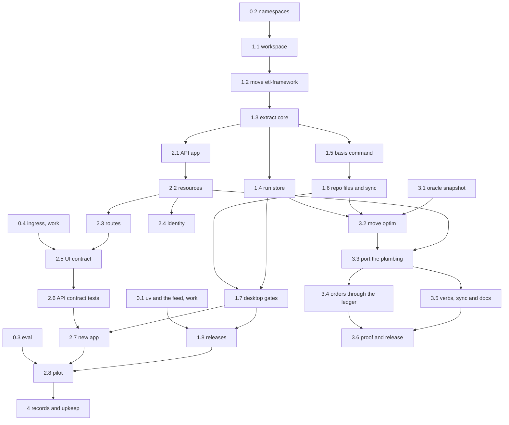

# Roadmap

This roadmap is the build order for basis: five phases, the steps in each, what each step needs first, and when it is
done. Steps in different lanes run at the same time. For the reasons behind each piece, see [the design](design.md).
basis-ui has [a roadmap of its own](https://github.com/jacobragsdale/basis-ui/blob/main/docs/roadmap.md), and the two
meet at the contract (step 2.5) and the pilot (step 2.8).

Steps marked **(work)** need the firm's environment: a Citrix desktop, the Azure DevOps feed and pipelines, the AKS
cluster, or the QA databases. They are the maintainer's to run or hand on, with the exact commands to run and what to
send back. Every other step runs here, against containers and synthetic data, and this repo's own CI runs on GitHub
Actions.

## Lanes

| Lane | Builds | Phases |
|---|---|---|
| A. Core and jobs | `basis-core`, `basis-job` | 1, 4 |
| B. APIs | `basis-api` | 2 |
| C. Optim | `optim` | 3 |
| D. Eval | `evals/` | 0, then every phase |

The critical path runs through lanes A and B: the namespace spike, the workspace, etl-framework's move, `basis-core`'s
extraction, the `basis` command, the repo files, the desktop gates, then the API and the pilot. Optim is off the
critical path, and runs alongside phase 2.

## Rules for working in parallel

1. Each step is one branch and one git worktree, named after its id, such as `1.3-extract-core`, and merges to `main`
   through a pull request whose CI is green.
2. Changes to `basis-core` land one pull request at a time. A lane that needs a change to `basis-core` opens that pull
   request on its own, and builds on it after it merges, so that two lanes never reshape it at once.
3. Steps in the same package split by module, so that two agents never edit the same files.
4. A step ends with the repo's checks green and its docs updated. A spike ends with its written result in
   `docs/spikes/`.
5. A step marked **(work)** goes to the maintainer as a list of commands to run and what to send back.

## Phase 0: spikes

Every spike runs at once. Each writes `docs/spikes/NAME.md` with the versions it used, a yes or no for each question,
and the fallback for each no.

1. **0.1 uv and the feed (work).** On a Citrix desktop, on Windows and in WSL: install uv without admin rights; set a
   user-level `uv.toml` that makes the Azure Artifacts feed the default index, with keyring or token authentication;
   `uvx` a test package from it; and publish a wheel to it from an Azure DevOps pipeline. Done when the result holds the
   setup steps `basis doctor` checks and the pipeline steps step 1.8 uses.
2. **0.2 Namespaces.** Build a uv workspace of two distributions that both add to the `basis` namespace (`basis.core`,
   `basis.job`). Check editable installs, ruff, ty, grimp and an import-linter contract across them, then build a wheel
   of each. The fallback is top-level names, `basis_core` and `basis_job`. Done when the result says which names phase 1
   uses.
3. **0.3 Eval.** Install Harbor and write five tasks against etl-framework 0.1.0, which exists today, graded by its own
   checks. Run one agent three times per task, and report the pass rate, the consistency across runs, the loop time and
   the tokens. Done when `evals/` holds the tasks, the runner and a first report.
4. **0.4 Ingress (work).** On the AKS cluster, route `/api` on one host to an API's service and the rest of the host to
   a UI's. Done when the result says whether UIs and APIs can share one origin, or whether APIs need their allowed
   origins declared.

## Phase 1: the repo and basis-core

Lane A. Needs spike 0.2.

1. **1.1 Workspace.** Set up `packages/core` and `packages/job` as uv workspace members, with:
   - root ruff and ty settings with every rule an error, as etl-framework has them;
   - the import contract: `core` imports nothing else, and `job`, `api` and `optim` import `core` only;
   - GitHub Actions CI, which runs only the jobs whose paths changed;
   - this repo's own commit hook.

   Done when an empty `core` and `job` pass CI.
2. **1.2 Move etl-framework.** Bring etl-framework into `packages/job` with its history (`git subtree add`, or `git
   filter-repo` and a merge), with its code and tests unchanged. Needs 1.1. Done when its 90 unit and 33 integration
   tests pass in this repo's CI, against SQL Server and Oracle service containers.
3. **1.3 Extract basis-core.** Move to `packages/core`:
   - each dialect's read and write paths, from `databases/`;
   - `settings`, `logs`, `storage` and `snapshots`;
   - publishing with the ledger;
   - the generic halves of `runs` (`replay`, `regress`, `resume`);
   - the `new` and `sync` machinery, and the shared templates;
   - the contract-test helpers, including the end-to-end safeguards.

   `basis.job` keeps the job contract (`job`, `params`, `rows`, `inputs`, `outputs`, `interval`, `changes`,
   `destination`, `ddl`, `diff`, its loader) and its example, templates, skills and docs. Imports are renamed from
   `etl_framework` to `basis.job` and `basis.core`. Needs 1.2. Done when the same 123 tests pass, split across the two
   packages, and the import contract holds.
4. **1.4 Run store.** Add content-addressed objects and manifests to `basis.core`. `basis.job` writes its snapshots
   there, and `replay`, `resume` and `regress` read them. Needs 1.3. Done when a run that loads the same input twice
   stores it once, and `replay`, `resume` and `regress` pass their tests on the new layout.
5. **1.5 The basis command.** Build `basis.core`'s command, with verbs that each installed part adds through entry
   points:
   - `basis.core`: `check`, `sync`, `replay`, `regress`, `new` and `docs`;
   - `basis.job`: `run`, `resume`, `ddl` and `describe`;
   - `basis --help` lists only the verbs of the repo it runs in;
   - every failure is one `ERROR` line with its fix;
   - the scaffolding command `basis-job new repo` for `uvx`.

   Needs 1.3, and can run alongside 1.4.
6. **1.6 Repo files and sync.** Add `basis.core`'s templates, each opening with its "managed by basis" line:
   - the Dockerfile: one image under `tini`, with an entry point per part;
   - `azure-pipelines.yml`: the deploy pipeline calling the team's templates, with a `basis check --full` stage ready
     for when CI exists;
   - `.githooks/pre-commit` and `.githooks/pre-push`, and setting `core.hooksPath` from any `basis` command;
   - `.gitattributes` with LF line endings;
   - `AGENTS.md` blocks per part, prefixed skills with their `.claude/skills/` copy, the Claude Code setting that denies
     `--no-verify`, and the drift check.

   Needs 1.5. Done when `uvx --from 'git+https://github.com/jacobragsdale/basis#subdirectory=packages/job' basis-job new
   repo loads` makes a repo that passes `basis check`, whose image builds, runs its example job and publishes it to the
   SQL Server container.
7. **1.7 Desktop gates.** Add:
   - the QA tier, with the end-to-end safeguards;
   - `basis check --full`;
   - `basis review`, with `regress`'s changes and the commit it checked;
   - `basis doctor`, on Windows and in WSL;
   - `basis upgrade`.

   Needs 1.4 and 1.6. Done when a generated repo's push hook runs `regress` against a local store and the QA tier
   against the SQL Server container standing in for QA, and `basis review` prints both.
8. **1.8 Releases.** One tag releases every package at one version, each depending on `basis-core` at exactly that
   version, and attaches the wheels to a GitHub release. **(work)** Publish to the internal feed through Azure DevOps,
   with spike 0.1's steps. Point etl-framework's README at basis; archiving that repo is the maintainer's call. Needs
   1.7. Done when `v0.1.0` is tagged, and installs from git here and from the internal feed at the firm.

## Phase 2: APIs

Lane B. Needs step 1.3. Steps 2.3 and 2.4 run at once.

1. **2.1 The app.** Build the FastAPI app from a service's declarations, with:
   - settings;
   - JSON logs and OpenTelemetry traces;
   - RFC 9457 errors from one exception map;
   - health and readiness endpoints;
   - graceful shutdown;
   - `basis serve`.
2. **2.2 Resources.** Add declared resources: databases, through `basis.core`'s dialects, whose writes commit in one
   transaction after the handler returns and the response validates; an HTTP client; a cache; and the clock and ids.
   Every resource call gets a deadline and a trace span, and every resource a fake. Its changes to `basis.core` follow
   rule 2. Needs 2.1.
3. **2.3 Routes.** Add strict request models; each route's declared deadline, response model and errors; declared pure
   compute running in a process pool; and `basis call ROUTE` and `basis dev`. Needs 2.2.
4. **2.4 Identity.** Verify the JWT's signature, expiry, issuer and audience. A missing token is anonymous and an
   invalid one gets a 401. Handlers see `User | None`, and the development signing key is refused anywhere but a
   desktop. Needs 2.2.
5. **2.5 The UI contract.** Commit `openapi.json`, with operation ids taken from handler names and strict models. Check
   it against the last release tag, failing on a removed, renamed or retyped field. Add Arrow responses for
   `application/vnd.apache.arrow.stream`, and the allowed-origins setting, whose need spike 0.4 decides. Write the
   contract page in this repo's docs, and publish the example API's `openapi.json` as the sample basis-ui tests against.
   Needs 2.3 and spike 0.4.
6. **2.6 Contract tests.** The app builds on fakes; every route declares what it must; `openapi.json` is current;
   Schemathesis runs on fakes; the import check passes; the agent files match. `basis review` adds the API contract's
   diff. Needs 2.5.
7. **2.7 New app.** `basis-api new app NAME` writes the API part, adds jobs through `basis.job`'s generator, and writes
   `basis.core`'s repo files. Needs 1.7 and 2.6. Done when a generated repo with an API and a job passes `basis check
   --full`, and its image serves the API and runs the job.
8. **2.8 Pilot (work).** Create a pilot API repo with `uvx basis-api new app pilot`, beside basis-ui's pilot UI repo,
   from the internal feed. Deploy both to QA through their generated pipelines, behind one host if spike 0.4 allows it.
   Lane D adds API tasks to the eval and runs them against the pilot. Needs 2.7, 1.8 and spike 0.3. Done when `new app`
   reaches QA in one pipeline run and the loop time is recorded against the hook's one-minute budget.

## Phase 3: optim on basis-core

Lane C. Needs steps 1.4 and 1.6. Its plumbing port waits for step 2.2's changes to `basis-core` to merge, so that
`basis-core` isn't reshaped under it. It runs alongside phase 2.

1. **3.1 Oracle snapshot.** With optim 0.2.0 as it is, run the example model on its fixture, and keep the snapshot and
   its decisions as the oracle for step 3.6. It can run at any time before 3.2.
2. **3.2 Move optim.** Bring portfolio-optim into `packages/optim` with its history.
3. **3.3 Port the plumbing.** Replace optim's sources, settings, logs, storage and snapshots with `basis.core`'s, and
   delete optim's copies, the SQL Server snapshot defect with them. optim's per-portfolio batching (ids bound as JSON, a
   semaphore per source, a read-only transaction per batch) stays optim's own, built on `basis.core`'s reads. Needs 3.2
   and 2.2.
4. **3.4 Orders through the ledger.** Orders are written through `basis.core`'s publishing, with a ledger row in the
   same transaction, and `resume` finishes a partial write. Needs 3.3.
5. **3.5 Verbs, sync and docs.** optim's verbs (`run`, `replay`, `sweep`, `describe`, `regress`, `new model`) come under
   `basis`, with `optim` as an alias. Its `sync`, `new` and docs printing move onto `basis.core`'s machinery, while its
   templates, skills and docs stay its own. `uvx optim new repo` works from the feed. Needs 3.3, and runs alongside 3.4.
6. **3.6 Proof and release.** Done when the example model's decisions on its fixture match step 3.1's exactly (`basis
   regress` against its snapshot), and a generated model repo with a second model passes its checks. optim then releases
   with the next basis version. Needs 3.4 and 3.5.

## Phase 4: records and upkeep

Lanes A, B and D. Needs step 2.8.

1. **4.1 Request records.** Record API requests to the run store under each route's record policy, with `basis replay`
   of one request and `basis regress` over a sample of recorded requests, run on desktops.
2. **4.2 Records for UIs.** Add `basis records export`, writing chosen requests and responses in the format basis-ui's
   fixture mode reads.
3. **4.3 Release gates.** Before a basis release, the maintainers run `basis upgrade` on representative repos, whose
   `regress` lists every changed output and response.
4. **4.4 Cleanup.** Add a golden-principles file to the synced files, and a scheduled cleanup agent that opens
   refactoring pull requests against it, each gated by `regress`.
5. **4.5 Tuning by eval.** Every release runs the eval. An error message, skill or doc page changes only when the eval
   shows the change helps.
6. **4.6 CI (work).** When the firm builds CI, turn on the generated pipeline's `basis check --full` stage, and add a
   branch policy on `main` that requires it.
