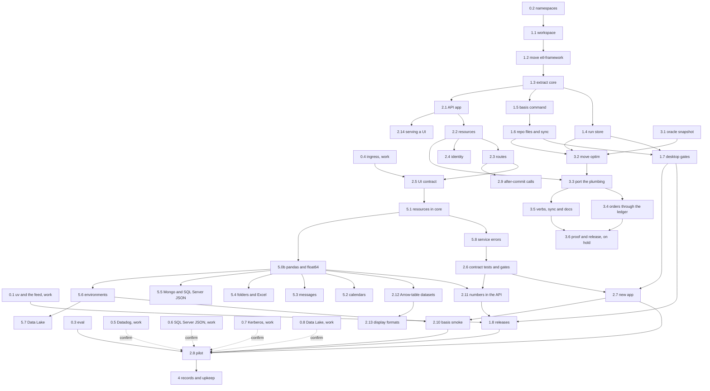

# Roadmap

This roadmap is the build order for basis: six phases, the steps in each, what each step needs first, and when it is
done. Steps in different lanes run at the same time. For the reasons behind each piece, see [the design](design.md).
basis-ui has [a roadmap of its own](https://github.com/jacobragsdale/basis-ui/blob/main/docs/roadmap.md), and the two
meet at the contract (step 2.5, which steps 2.11 and 2.13 change) and the pilot (step 2.8).

Steps marked **(work)** need the firm's environment: a Citrix desktop, the Azure DevOps feed and pipelines, the AKS
cluster, or the QA databases. They are the maintainer's to run or hand on, with the exact commands to run and what to
send back. Every other step runs here, against containers and synthetic data, and this repo's own CI runs on GitHub
Actions.

## Lanes

| Lane | Builds | Phases |
|---|---|---|
| A. Core and jobs | `basis-core`, `basis-job` | 1, 4, 5 |
| B. APIs | `basis-api` | 2, and basis-api's side of 5.1 and 5.8 |
| C. Optim (provisional) | `optim` | 3 |
| D. Eval | `evals/` | 0, then every phase |

The critical path runs through lanes A and B: the namespace spike, the workspace, etl-framework's move, `basis-core`'s
extraction, the `basis` command, the repo files, the desktop gates, the API, and its resources' move into `basis-core`
(step 5.1). From there it forks, through the service errors (5.8), the contract tests and gates (2.6) and the new app
(2.7) on one side, and pandas (5.0b) and environments (5.6) on the other, and joins at `basis smoke` (2.10), before
the pilot, which confirms spikes 0.5 to 0.8 at the firm; no step waits for those spikes. Step 2.11 is on it too, since
the first release (1.8) waits for it. Steps 2.12 to 2.14, 5.2 to 5.5 and 5.7 are off it. Optim is off the critical
path, and runs alongside phase 2. Its design is provisional until the maintainer meets the firm's quant team, and
nothing in lanes A and B may depend on it (see [the design](design.md#the-packages)).

## Rules for working in parallel

1. Each step is one branch and one git worktree, named after its id, such as `1.3-extract-core`, and merges to `main`
   through a pull request whose CI is green.
2. Changes to `basis-core` land one pull request at a time. A lane that needs a change to `basis-core` opens that pull
   request on its own, and builds on it after it merges, so that two lanes never reshape it at once.
3. Steps in the same package split by module, so that two agents never edit the same files.
4. A step ends with the repo's checks green and its docs updated. A spike ends with its written result in
   `docs/spikes/`.
5. A step marked **(work)** goes to the maintainer as a list of commands to run and what to send back.

## Phase 0: spikes

Every spike runs at once. Each writes `docs/spikes/NAME.md` with the versions it used, a yes or no for each question,
and the fallback for each no. Spikes 0.5 to 0.8 are the exception: little in them is particular to the firm, so each
starts as desk research, whose best guesses its phase 5 step builds to, and its questions become a short checklist that
the pilot (2.8) confirms at the firm, fixing there whatever is wrong.

1. **0.1 uv and the feed (work).** On a Citrix desktop, on Windows and in WSL: install uv without admin rights; set a
   user-level `uv.toml` that makes the Azure Artifacts feed the default index, with keyring or token authentication;
   `uvx` a test package from it; and publish a wheel to it from an Azure DevOps pipeline. Done when the result holds the
   setup steps `basis doctor` checks and the pipeline steps step 1.8 uses.
2. **0.2 Namespaces.** Build a uv workspace of two distributions that both add to the `basis` namespace (`basis.core`,
   `basis.job`). Check editable installs, ruff, ty, grimp and an import-linter contract across them, then build a wheel
   of each. The fallback is top-level names, `basis_core` and `basis_job`. Done when the result says which names phase 1
   uses.
3. **0.3 Eval.** Install Harbor and write five tasks against etl-framework 0.1.0, which exists today, graded by its own
   checks. Run one agent three times per task, and report the pass rate, the consistency across runs, the loop time and
   the tokens. Done when `evals/` holds the tasks, the runner and a first report.
4. **0.4 Ingress (work).** On the AKS cluster, route `/api` on one host to an API's service, removing the prefix, and
   the rest of the host to a UI's. Done when the result says whether UIs and APIs can share one origin, with the API
   seeing its paths without `/api`, as its `openapi.json` gives them, or whether APIs need their allowed origins
   declared.
5. **0.5 Datadog (work).** On the AKS cluster: does the Datadog Agent accept OTLP, and on which host and port? Does it
   collect containers' logs? Which format of trace id links a log record to its trace? Done when
   `docs/spikes/datadog.md` gives a best guess for each, for step 5.1, and its checklist for the pilot.
6. **0.6 SQL Server JSON (work).** Does mssql-python handle SQL Server's native `json` type, in reads, writes and
   `CREATE TABLE`? Done when `docs/spikes/sqlserver-json.md` gives a best guess, for step 5.5, and its checklist for the
   pilot.
7. **0.7 Kerberos (work).** Do Kerberos logins work with mssql-python, in WSL and in a pod, and with oracledb, whose
   thin mode may not support Kerberos? Done when `docs/spikes/kerberos.md` gives a best guess for each, for step 5.6,
   and its checklist for the pilot.
8. **0.8 Data Lake (work).** Does `pyarrow.fs.AzureFileSystem` sign in to the firm's storage account with workload
   identity in a pod, and with the Azure CLI on a desktop? Does the account have the hierarchical namespace, so a rename
   is atomic? Done when `docs/spikes/data-lake.md` gives a best guess for each, for step 5.7, and its checklist for the
   pilot.
9. **0.9 berth fit.** Does a repo `basis-api new app` makes deploy through berth, the proposed deploy repository, as
   berth stands? Done: `docs/spikes/berth.md` lists each mismatch with a fix on basis's side, and two decisions for the
   maintainer (a relative interval for scheduled runs, and the service name Datadog sees).

## Phase 1: the repo and basis-core

Lane A. Needs spike 0.2.

1. **1.1 Workspace.** Set up the uv workspace with `packages/core` as its first member, with:
   - root ruff and ty settings with every rule an error, as etl-framework has them, and pytest in importlib mode (spike
     0.2);
   - GitHub Actions CI, which skips changes to docs alone;
   - this repo's own commit hook.

   `packages/job` arrives in step 1.2 with etl-framework, and the import contract with it, since import-linter needs
   the second package to have something to forbid. Done when an empty `core` passes CI.
2. **1.2 Move etl-framework.** Bring etl-framework into `packages/job` with its history (`git subtree add`, or `git
   filter-repo` and a merge), with its code and tests unchanged. Needs 1.1. Done when its 90 unit and 33 integration
   tests pass in this repo's CI, against SQL Server and Oracle service containers.
3. **1.3 Extract basis-core.** Move to `packages/core`:
   - each dialect's read and write paths, from `databases/`;
   - `settings`, `logs`, `storage` and `snapshots`;
   - publishing with the ledger;
   - the generic halves of `runs` (`replay`, `regress`, `resume`);
   - the `new` and `sync` machinery, and the shared templates;
   - the contract-test helpers, including the end-to-end safeguards.

   `basis.job` keeps the job contract (`job`, `params`, `rows`, `inputs`, `outputs`, `interval`, `changes`,
   `destination`, `ddl`, `diff`, its loader) and its example, templates, skills and docs. Imports are renamed from
   `etl_framework` to `basis.job` and `basis.core`. Needs 1.2. Done when the same 123 tests pass, split across the two
   packages, and the import contract holds.
4. **1.4 Run store.** Add content-addressed objects and manifests to `basis.core`. `basis.job` writes its snapshots
   there, and `replay`, `resume` and `regress` read them. Needs 1.3. Done when a run that loads the same input twice
   stores it once, and `replay`, `resume` and `regress` pass their tests on the new layout.
5. **1.5 The basis command.** Build `basis.core`'s command, with verbs that each installed part adds through entry
   points:
   - `basis.core`: `check`, `sync`, `replay`, `regress`, `new` and `docs`;
   - `basis.job`: `run`, `resume`, `ddl` and `describe`;
   - `basis --help` lists only the verbs of the repo it runs in;
   - every failure is one `ERROR` line with its fix;
   - the scaffolding command `basis-job new repo` for `uvx`.

   Needs 1.3, and can run alongside 1.4.
6. **1.6 Repo files and sync.** Add `basis.core`'s templates, each opening with its "managed by basis" line:
   - the Dockerfile: one image under `tini`, with an entry point per part;
   - `azure-pipelines.yml`: the deploy pipeline calling the team's templates, with a `basis check --full` stage ready
     for when CI exists;
   - `.githooks/pre-commit` and `.githooks/pre-push`, and setting `core.hooksPath` from any `basis` command;
   - `.gitattributes` with LF line endings;
   - `AGENTS.md` blocks per part, prefixed skills with their `.claude/skills/` copy, the Claude Code setting that denies
     `--no-verify`, and the drift check.

   Needs 1.5. Done when `uvx --from 'git+https://github.com/jacobragsdale/basis#subdirectory=packages/job' basis-job new
   repo loads` makes a repo that passes `basis check`, whose image builds, runs its example job and publishes it to the
   SQL Server container.
7. **1.7 Desktop gates.** Add:
   - the QA tier, with the end-to-end safeguards;
   - `basis check --full`;
   - `basis review`, with `regress`'s changes and the commit it checked;
   - `basis doctor`, on Windows and in WSL;
   - `basis upgrade`.

   Needs 1.4 and 1.6. Done when a generated repo's push hook runs `regress` against a local store and the QA tier
   against the SQL Server container standing in for QA, and `basis review` prints both.
8. **1.8 Releases.** One tag releases basis-core, basis-job and basis-api at one version, each depending on
   `basis-core` at exactly that version, and attaches their wheels to a GitHub release. optim keeps the same version in
   the repo, built and green with the rest, but is not published until step 3.6. **(work)** Publish to the internal feed through Azure DevOps,
   with spike 0.1's steps. Point etl-framework's README at basis; archiving that repo is the maintainer's call. Needs
   1.7 and 2.11: the first tag, `v0.1.0`, comes after 2.11, so the first release already has the float contract and
   basis-ui pins its sample once. Done when `v0.1.0` is tagged, and installs from git here and from the internal feed
   at the firm.

## Phase 2: APIs

Lane B. Needs step 1.3. Steps 2.3 and 2.4 run at once, and so do 2.5 and 2.9.

1. **2.1 The app.** Build the FastAPI app from a service's declarations, with:
   - settings;
   - JSON logs and OpenTelemetry traces;
   - RFC 9457 errors from one exception map;
   - health and readiness endpoints;
   - graceful shutdown;
   - `basis serve`.
2. **2.2 Resources.** Add declared resources: databases, through `basis.core`'s dialects, whose writes commit in one
   transaction after the handler returns and the response validates; an HTTP client; a cache; and the clock and ids.
   Every resource call gets a deadline and a trace span, and every resource a fake. Its changes to `basis.core` follow
   rule 2. Needs 2.1.
3. **2.3 Routes.** Add strict request models; each route's declared deadline, response model and errors; declared pure
   compute running in a process pool; and `basis call ROUTE` and `basis dev`. Needs 2.2.
4. **2.4 Identity.** Verify the JWT's signature, expiry, issuer and audience. A missing token is anonymous and an
   invalid one gets a 401. Handlers see `User | None`, and the development signing key is refused anywhere but a
   desktop. Needs 2.2.
5. **2.5 The UI contract.** Commit `openapi.json`, with operation ids taken from handler names and strict models. Check
   it against the last release tag, failing on a removed, renamed or retyped field. Add Arrow responses for
   `application/vnd.apache.arrow.stream`, and the allowed-origins setting, whose need spike 0.4 decides. Write the
   contract page in this repo's docs, and publish the example API's `openapi.json` as the sample basis-ui tests against.
   Needs 2.3 and spike 0.4.
6. **2.6 Contract tests and gates.** The app builds on fakes; every route declares what it must; `openapi.json` is
   current; Schemathesis runs on fakes; the agent files match. `basis review` adds the API contract's diff. `basis
   check` adds the gates [the design](design.md) gives:
   - an API's layers, known by module name at any depth: imports go downward only, which grimp checks with no
     configuration file; domain modules stay pure, as compute modules are; and a handler passes a resource on and never
     calls its methods;
   - every generated repo's tests: branch coverage from unit tests at the floor `[tool.basis] coverage` gives, with
     repository modules left out; no `unittest.mock` or pytest-mock, but in a file whose one-line comment gives its
     reason; and no sockets in unit tests;
   - mutmut on the domain functions a change touches, in `basis check --full`, reported in `basis review` and never
     blocking, in WSL or on Linux only.

   Needs 2.5, 5.1 and 5.8, and step 2.11 needs it. Done when the example API passes them all, a copy of it that breaks
   any one fails `basis check` with that rule's fix, and `basis review` lists a mutant that survived.
7. **2.7 New app.** `basis-api new app NAME` writes the API part in its layers (`service.py`, `handlers.py`,
   `repository.py` and `domain.py`, with `resources.py` and `errors.py`), `[tool.basis] coverage = 90`, and the
   development dependencies the gates run, pytest-cov, mutmut for Linux and Schemathesis, adds jobs
   through `basis.job`'s generator, and writes `basis.core`'s repo files. Needs 1.7, 2.6 and 5.1. Done when a
   generated repo with an API and a job passes `basis check --full`, and its image serves the API and runs the job.
8. **2.8 Pilot (work).** Create a pilot API repo with `uvx basis-api new app pilot`, beside basis-ui's pilot UI repo,
   from the internal feed. Deploy both to QA through their generated pipelines, behind one host if spike 0.4 allows it.
   Lane D adds API tasks to the eval and runs them against the pilot. Needs 2.7, 2.10, 1.8, 5.1 and spike 0.3, so it
   reports to Datadog from its first day, proves `basis smoke` after its deploy to QA, and starts on pandas rather than
   polars, and it confirms the checklists of spikes 0.5 to 0.8, fixing whatever they find wrong.
   Done when `new app` reaches QA in one pipeline run and the loop time is recorded against the hook's one-minute
   budget.
9. **2.9 After-commit calls.** Add the outbox, as the design has it: a state-changing call an `api.Client` sends with
   an idempotency key, written as a row of the outbox table in the route's transaction and made once after the commit,
   within the route's deadline, with `Idempotency-Key`; the relay, a scheduled basis job, which retries each row with
   backoff until the other service accepts it or the row ages out, and alerts then; and the outbox table's DDL. Needs
   2.3, and runs alongside 2.5; the pilot (2.8) does not wait for it. Done when, against the SQL Server and Oracle
   containers and a fake service, a route whose writes roll back makes no call, and a call that fails after its commit
   reaches the service through the relay, with its key, once the service answers again.
10. **2.10 `basis smoke`.** `basis smoke --env ENV` checks an environment after each deploy, and from a desktop:
    - the served `openapi.json` equals the committed one;
    - the API is ready;
    - each route that declares a read-only example, `smoke=`, answers it, and its response validates;
    - a job dry-runs on that environment's inputs for a recent interval, running its transform and checks and
      publishing nothing.

    A failure blocks promotion to prod. It makes no journeys across services, and needs no test tenancy, Pact, chaos
    testing or canary analysis, for the reasons [the design](design.md#gates-without-ci) gives. Needs 2.7 and 5.6, and
    the pilot (2.8) needs it. Done when it passes on a generated repo with an API and a job, against the containers
    standing in for QA, and fails, with its fix, when the served document differs from the committed one, an example's
    response does not validate, or a job's checks fail; and the generated pipeline runs it before promotion to prod.
11. **2.11 Numbers in the API.** basis-api's side of [numbers](design.md#numbers), with what goes with it:
    - every number is a JSON number, never a string, so the decimal-string parsing and `x-basis-decimal` go;
    - dataset rows take `float` for every number, and refuse `int` and `Decimal` fields, with the fix, and an enum or
      `Literal` of integers, whose fix says to use a `str` enum or a `Literal` of strings; other route models refuse
      `Decimal`, and keep `int` as a JSON number;
    - a dataset's float column is always nullable, in the Arrow schema and in the document;
    - NaN and ±inf are null on the wire, in JSON and Arrow alike;
    - the example service's numbers become floats, which changes the sample `openapi.json` basis-ui pins;
    - `basis check`'s rounding gate, which refuses `round()`, `.round()`, `numpy.round`, `numpy.around`, `numpy.rint`
      and the `decimal` module in user code, saying to leave rounding to the UI. How a business-rounding function is
      marked is still open, pending the maintainer;
    - a test that, in a repo whose `pyproject.toml` has no `[tool.basis]` table, `basis` refuses every verb that reads
      or writes the repo's files, and allows `--version`, `doctor` and `docs`.

    No release exists yet, so the breaking-change check passes, as having no earlier release, and the first release
    (1.8) waits for this step. Needs 5.0b and 2.6. Done when the example's `openapi.json` shows numbers as numbers,
    basis-ui is told, and the rounding gate refuses a `round()` with its fix.
12. **2.12 Arrow-table datasets.** A dataset route may return a pandas frame or an Arrow table, declared as
    `response=api.Table[Row]`, as [the design](design.md#apis-basisapi) has it: checked once against the row model's
    names, types, nulls and time zones, never row by row, with a mismatch a 500 defect whose request's writes roll
    back; a `Table` row model with value constraints refused when it is declared; `Reader.fetch_table(Row, SQL, ...)`,
    reading Arrow straight from the driver; and the route's JSON rendered column-wise from the Arrow. `call` and `dev`
    become library functions as well as verbs. Needs 5.0b. Done when a 100,000-row dataset is measured both ways:
    through pydantic, and as a table.
13. **2.13 Display formats.** A dataset's float field declares its display format, as
    `Annotated[float, api.format.money("USD")]`, in the shape agreed with basis-ui
    ([the contract](contract.md#display-formats)): basis-api writes it into the Arrow field's metadata as
    `basis.format` and into `openapi.json` as `x-basis-format`, with ISO 4217's codes and minor units shipped as data,
    and refuses an unknown kind, a bad currency or an out-of-range `decimals` when the route is declared. Needs 2.12. Done
    when the example's dataset declares a format on its number columns, its Arrow and its `openapi.json` carry them,
    each refusal fails with its fix, and basis-ui is told.
14. **2.14 Serving a UI.** basis-api serves a built UI folder at `/` from the same app, so one container serves a UI
    and its API on one origin. An app that serves one mounts its routes under `/api`; the document's paths stay
    unprefixed, and its `servers` lists `/api`. Spike 0.4's ingress gives one origin by routing `/api` to the API's
    service, removing the prefix, and the rest to the UI's; this gives it without an ingress split, as ctzd's apps
    need. An app without a UI is unchanged. Needs 2.1. Done when one app serves a built folder at `/` and its routes
    under `/api`, from one container.

## Phase 3: optim on basis-core

Lane C. Needs steps 1.4 and 1.6. Its plumbing port waits for step 2.2's changes to `basis-core` to merge, so that
`basis-core` isn't reshaped under it. It runs alongside phase 2. Steps 3.1 to 3.5 are done; optim's design is
provisional until the maintainer meets the firm's quant team, so step 3.6 is on hold until then, and what optim becomes
may replace it. Whatever it becomes, nothing outside `packages/optim` may depend on it, which CI's `without-optim` job
checks.

1. **3.1 Oracle snapshot.** With optim 0.2.0 as it is, run the example model on its fixture, and keep the snapshot and
   its decisions as the oracle for step 3.6. It can run at any time before 3.2.
2. **3.2 Move optim.** Bring portfolio-optim into `packages/optim` with its history.
3. **3.3 Port the plumbing.** Replace optim's sources, settings, logs, storage and snapshots with `basis.core`'s, and
   delete optim's copies, the SQL Server snapshot defect with them. optim's per-portfolio batching (ids bound as JSON, a
   semaphore per source, a read-only transaction per batch) stays optim's own, built on `basis.core`'s reads. Needs 3.2
   and 2.2.
4. **3.4 Orders through the ledger.** Orders are written through `basis.core`'s publishing, with a ledger row in the
   same transaction, and `resume` finishes a partial write. Needs 3.3.
5. **3.5 Verbs, sync and docs.** optim's verbs (`run`, `replay`, `sweep`, `describe`, `regress`, `new model`) come under
   `basis`, with `optim` as an alias. Its `sync`, `new` and docs printing move onto `basis.core`'s machinery, while its
   templates, skills and docs stay its own. `uvx optim new repo` works from the feed. Needs 3.3, and runs alongside 3.4.
6. **3.6 Proof and release (on hold).** Done when the example model's decisions on its fixture match step 3.1's exactly (`basis
   regress` against its snapshot), and a generated model repo with a second model passes its checks. optim then releases
   with the next basis version. Needs 3.4 and 3.5, and the maintainer's meeting with the quant team.

## Phase 4: records and upkeep

Lanes A, B and D. Needs step 2.8.

1. **4.1 Request records.** Record API requests to the run store under each route's record policy, off unless a
   deployment turns it on, with `basis replay` of one request and `basis regress` over a sample of recorded requests,
   run on desktops.
2. **4.2 Records for UIs.** Add `basis records export`, writing chosen requests and responses in the format basis-ui's
   fixture mode reads.
3. **4.3 Release gates.** Before a basis release, the maintainers run `basis upgrade` on representative repos, whose
   `regress` lists every changed output and response.
4. **4.4 Cleanup.** Add a golden-principles file to the synced files, and a scheduled cleanup agent that opens
   refactoring pull requests against it, each gated by `regress`.
5. **4.5 Tuning by eval.** Every release runs the eval. An error message, skill or doc page changes only when the eval
   shows the change helps.
6. **4.6 CI (work).** When the firm builds CI, turn on the generated pipeline's `basis check --full` stage, and add a
   branch policy on `main` that requires it.

## Phase 5: resources

Lane A, with basis-api's side of 5.1 and 5.8 in lane B. Jobs and APIs share one set of tools: today basis-api alone has
the HTTP client, the clock, ids and OpenTelemetry tracing, and jobs get only databases and logs. Steps 5.0b and 5.8
need 5.1, steps 2.11, 2.12 and 5.2 to 5.7 need 5.0b, and 5.7 needs 5.6 too. They run in parallel, and their pull
requests to `basis-core` merge one at a time (rule 2). The reasons are in [the design](design.md#what-jobs-and-apis-share).

1. **5.1 Resources in core.** Move basis-api's resource model into `basis.core`: a declared resource, with a deadline,
   a trace span and a fake. The HTTP client (httpx2, with its proxy and CA bundle), the clock, ids and OpenTelemetry
   tracing move with it, so jobs get them too, and basis-api builds on core's. With it:
   - every run and request is a trace, and every SQL statement and HTTP call a span, which the OpenTelemetry SDK sends
     over OTLP to the Datadog Agent on each AKS node, with no Datadog library;
   - logs stay JSON on stderr, never files on NFS, and each record carries its trace's and span's ids;
   - there are no custom metrics, since Datadog's APM derives request counts, errors and latency from the traces.

   Needs 2.5 merged, and no spike: it exports to the OTLP endpoint its settings name, and its tests run against an
   OpenTelemetry collector container or an in-process exporter. Steps 2.6 and 2.7 build on it. Done when a job's run and
   an API's request each make one trace, with a span for each SQL statement and HTTP call, and each of their log records
   carries its trace's and span's ids, in the format `docs/spikes/datadog.md` gives, which the pilot confirms.
2. **5.0b pandas and float64.** `basis.core` and `basis.job` hand frames to job code as pandas DataFrames, not polars
   ones, with numbers as [the design](design.md#numbers) has them:
   - every number is a plain numpy float64 column, with NaN for missing, and identifiers are text; strings and dates
     take pandas' nullable and Arrow-backed dtypes from the job's declared row type, so a time keeps its zone;
   - the drivers cast every numeric type of Oracle and SQL Server to float64 at the Arrow level, widen BINARY_FLOAT and
     real through their shortest decimal, and fail a query whose whole-number column holds a value beyond 2^53, naming
     the column;
   - row models take `float`, and refuse an `int` or `Decimal` field with the fix;
   - a float publishes into a DECIMAL column as its `repr`; into an INT column, a whole float publishes as integer
     text, and any other is refused; NaN publishes as NULL, and ±inf is refused;
   - `basis ddl` emits SQL Server `float` and Oracle `BINARY_DOUBLE`, and column kinds lose int and decimal;
   - `regress` compares numbers at 15 significant digits.

   polars leaves the lock, and pyarrow stays the I/O layer, for Parquet, the run store, Arrow responses and the lake.
   Needs 5.1, and steps 2.11, 2.12 and 5.2 to 5.7 need it, so Excel, Mongo and the lake are written once, in pandas.
   Done when basis-job's unit and integration tests pass on pandas frames, polars is gone from the lock, every numeric
   type the design lists reads as float64 from the SQL Server and Oracle containers, 2.675 publishes into a DECIMAL
   column of scale 2 as 2.68, and a float, a NaN and a zone-aware time each reach SQL Server, Oracle and the run store,
   and come back, as they left.
3. **5.2 Calendars.** Ship `sifma-us`, with its full and early closes, and `target2` in `basis.core`, as data built from
   SIFMA's and the ECB's published schedules, with no pandas. Each states the last date it covers. A job names its
   calendar, which says whether a date is a business day, adds business days, and gives the previous business day and a
   day's early-close time. Needs 5.0b. Done when each function agrees with both published schedules, and a date after a
   calendar's last is an error, never a business day.
4. **5.3 Messages.** Add Slack, through a channel's webhook, and email, through the firm's SMTP relay, each with a fake.
   Port parallax's number formatter to Python for their text, reading the same display format object as the UI
   ([the contract](contract.md#display-formats)), which ctzd moves onto. Needs 5.0b. Done when a job's tests send both
   through the fakes, its replay, regress and QA runs send nothing, and the port writes what parallax's Rust writes
   for each case in basis-ui's `packages/parallax/crates/parallax-engine/tests/fixtures/format.json`.
5. **5.4 Folders and Excel.** Add folders, each a named path, which each machine's settings give: `\\server\share` on
   Windows, and a mount path in WSL and in pods. Read and write Excel with pandas' `read_excel` (calamine) and
   `to_excel` (xlsxwriter), in an optional extra, `basis-core[excel]`. Each write goes to a temporary file, which is
   then renamed into place. Needs 5.0b. Done when a job reads a workbook from a folder and writes one to it, and a
   reader of the folder never sees a half-written file.
6. **5.5 Mongo and SQL Server JSON.** Add Mongo, in an optional extra, `basis-core[mongo]`: reads, and writes as upserts
   by a declared key, with no transactions and no ledger. Make SQL Server's native `json` columns work in reads,
   publishing and `basis ddl`. Needs 5.0b, and builds to `docs/spikes/sqlserver-json.md`. Done when a job that reads
   Mongo and publishes to a `json` column passes against a Mongo container and a SQL Server one whose version has the
   type, and a second upsert of the same documents changes nothing in Mongo.
7. **5.6 Environments.** Every command that touches the firm's systems takes `--env dev|qa|prod`, or `BASIS_ENV`, with
   no default. A desktop reads the user's file for that environment, `basis/ENV.env` in their own configuration folder
   (`~/.config/basis/ENV.env`, or `%APPDATA%\basis\ENV.env` on Windows), which holds its hosts, paths and secrets, and
   which every repo the user works in shares. A pod reads what its deployment sets, `BASIS_ENV` among it. A repo's
   `.env.example` lists the names it needs. What reads a settings file today fits as follows:
   - basis-job's `run(..., env=".env")` takes an environment rather than a file, as `env="qa"`, with no default
     environment, and reads the user's file for it, as `--env` does;
   - the QA tier reads the user's `qa.env`, still alone and never the process's environment, in place of the file
     `[tool.basis.qa] settings` names today, so that key goes. Its marker, stores and writes stay as they are.

   In prod, a run whose plan publishes or writes anything is refused at the start, with one `ERROR` line, unless the
   deployment sets one flag. That stops accidents, not malice, and the docs say the real control is a read-only prod
   login for desktops. Desktops write in dev and QA. Database logins stay as the settings have them. `basis doctor --env
   ENV` checks that each login works and each folder is reachable. Needs 5.0b, and builds to `docs/spikes/kerberos.md`.
   Done when a command that touches the firm's systems with no environment is refused with its fix, a prod run that
   would write is refused without the flag, and `basis doctor --env qa` reports on each login and folder.
8. **5.7 Azure Data Lake.** Add a lake destination: a job publishes an output as Parquet to a declared ADLS Gen2 path,
   partitioned by its run's interval, such as `CONTAINER/TABLE/date=2026-11-07/`, through `pyarrow.fs`. The
   environment's settings declare how it signs in: an account key or a SAS token, as a secret, or Entra ID, through
   workload identity in a pod and `az login` on a desktop. Each partition goes to a temporary path and is renamed into
   place, and the archive is done only when its files read back with the row count written. The job's database ledger
   records it like any publish, with the interval, the path, the row count and the files' hashes. Needs 5.0b and 5.6,
   builds to `docs/spikes/data-lake.md`, and runs alongside the other steps. Done when an interval's archive is in the
   lake with its row count checked and its ledger row written, a retry archives nothing, and `resume` and `--again` work
   on it as they do on a table.
9. **5.8 Service errors and failing fakes.** In `basis-core` and `basis-api`: one hierarchy of service errors, as [the
   design](design.md#what-jobs-and-apis-share) has it, `ServiceError`, with the resource, the status and the detail, and
   `Timeout`, `Unavailable`, `NotFound`, `Conflict`, `Rejected`, `Denied`, `BadReply` and `Failed`, which every
   resource and its fake raise alike, with the design's retries and responses, in place of `CallFailedError` and
   `DeadlineExceededError`. A fake fails on demand, as `pricing.fails("/prices/X", Unavailable)`, and basis ships a
   contract suite per resource, which its CI runs against the fake and the real resource. Needs 5.1, which has merged,
   and step 2.6 needs it. Done when each resource's suite passes against its fake and the real resource, and a test
   makes each kind of failure through a fake, with no mock, and sees the route answer with the design's status.

Later, and not yet stepped:

- SharePoint, through Microsoft Graph, which needs an app registration with `Sites.Selected`, and a **(work)** spike
  first;
- Slack bot apps;
- recorded HTTP responses, for replay;
- run locks;
- output checks;
- Azure Key Vault;
- deleting the rows a lake archive holds from its source database, as an explicit step of its own.

## Later: what the MVP leaves for the review

Since 2026-11-08 the maintainer has the work go fast to the MVP, one agent committing to `main`, with the review after.
These are left for it.

- **Step 2.6, from its review.** These are not fixed yet:
  - Schemathesis loads the service installed in the running environment, not the commit under check, so in the push
    hook's worktree it can test other code.
  - Purity is checked on modules named `domain`, not on every module inside a `domain` package.
  - The socket plugin blames the unit test that is running for a socket a leftover thread opens.
  - The folders basis never reads are listed in four places.
  - `layers.DECLARATIONS` is unused.
- **Schemathesis and mutmut are off by default.** `BASIS_FUZZ=1` turns Schemathesis on for `basis check`, and
  `BASIS_MUTATE=1` turns mutation testing on for `basis check --full`. Their own tests are marked `heavy`, which the
  default run leaves out; `uv run pytest -m heavy` runs them. Turning them back on is the review's call, and it moves
  the fuzz into `check --full` and builds the app once.
- **Step 2.11, left for the review.** `strict.py`'s decimal-string paths (`_precise`, `_inexact` and the second parse
  of a body) are unreachable now that a `Decimal` is refused when a route is declared; remove them. `basis docs`
  should run in a repo with no `[tool.basis]` table, as the design says; it is refused there today, and the change
  is in `command.py`, which step 5.6 is changing.
- **Compression, measured.** 100,000 rows of eight columns (two text, a date, five random floats), on the development
  host, with zlib: Arrow 7.2 MB to 3.44 MB at level 1 in 63 ms, 3.28 MB at 6 in 290 ms, 3.23 MB at 9 in 1.76 s; JSON
  20.9 MB to 5.00 MB at 1 in 82 ms, 4.23 MB at 6 in 254 ms. The app gzips at level 1 (`app.COMPRESS_LEVEL`). Real desk
  data, with fewer distinct values, compresses further. Brotli or zstd for the API's own answers would need a
  dependency, and Safari's zstd support; not done.
- **Step 2.12, measured.** 100,000 rows, on the development host: through pydantic (`list[Row]`), JSON 59 ms and
  Arrow 121 ms; as an `api.Table`, Arrow 7 ms and JSON 286 ms. A table's JSON goes through `to_pylist`, so a
  column-wise JSON writer would cut its 286 ms; Arrow, which basis-ui's grids read, is already the fast path.
